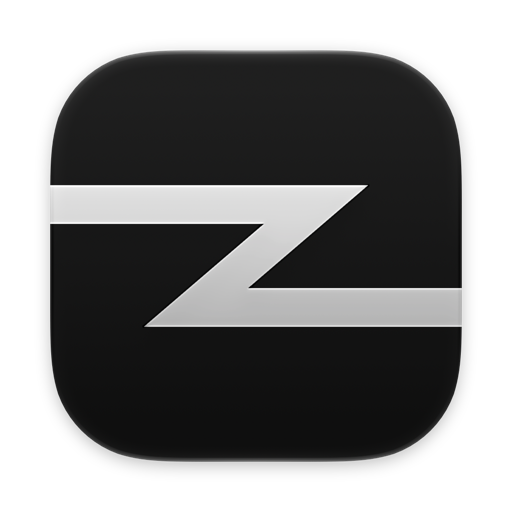

<p align="center">
  
</p>

# zz

zz is a terminal multiplexer with native terminal, Chromium browser and agent chat panes.
The daemon keeps sessions running when you close the desktop window. Attach from another
machine over SSH or a tailnet, from the [browser client](../knowledge/playbooks/browser-client.md),
or from the terminal with `zz attach`.

# Install

One command on macOS (Apple Silicon) and Linux:

```sh
curl -fsSL https://zzmux.sh/install.sh | sh
curl -fsSL https://zzmux.sh/install.sh | sh -s -- --headless   # CLI + daemon only, for hosts you ssh into
```

It picks the route for the machine: the notarized app into `/Applications`
with `zz` linked on your `PATH`, the `.deb` through apt where dpkg runs, and
the release tarball under `~/.local` everywhere else. Add `-s -- --beta` for the
newest beta, `--version 0.3.0` to pin one; rerun to upgrade.

Or through a package manager. macOS, Apple Silicon:

```sh
brew install --cask demfabris/zz/zz
```

AUR:

```sh
paru zz-bin
```

Betas ship to their own channel, `demfabris/zz/zz@beta` and `zz-beta-bin`, which
stable releases also update. Each conflicts with its stable sibling, so pick one.

Debian/Ubuntu 24.04+, from a release `.deb`:

```sh
sudo apt install ./zz-<version>-linux-<arch>.deb
```

# Development

Install [just](https://github.com/casey/just) 1.52 or newer. Run `just` to browse command
groups, `just web` to list browser commands, or `just --list --list-submodules` for the full tree.
Related commands use `just <group> <action> [arguments]`; `run`, `watch`, and `build` stay at the root.

## Prerequisites

- Rust 1.99.0
- Zig 0.16.0
- CMake 3.21+ and Ninja: the CEF C++ wrapper is compiled from source.
- Linux: `cmake curl desktop-file-utils ninja-build libfontconfig-dev libwayland-dev libx11-xcb-dev libxcb1-dev libxkbcommon-dev libxkbcommon-x11-dev`.
- Windows x64: Git for Windows (including Git Bash), the MSVC Rust toolchain, and Visual Studio 2022 Build Tools with the C++ tools and a Windows SDK.

```sh
just build mac
just install mac
just package mac
just package arch
just install arch
just package deb
just install deb
just web run
just web build --release
```

On Windows, build from PowerShell:

```powershell
powershell -ExecutionPolicy Bypass -File scripts/build-windows.ps1
```

The script loads the x64 Visual Studio environment and selects Microsoft's linker explicitly
to avoid Git Bash's `link.exe`. It runs `just build windows`, producing the complete app at
`dist/zz/zz.exe`. Keep the adjacent DLLs and resources with the executable. To package the bundle:

```powershell
powershell -File scripts/package-windows.ps1 dist/zz dist/zz-windows.zip
```

Before rebuilding an existing bundle, close its app and stop its daemon after finishing your
sessions: Windows cannot replace DLLs that those processes have loaded.

# Connecting

The sidebar shows every machine you have added, each expanding into its own
sessions, windows, and panes. Click a session to attach to it. Add one from the
menu on your own machine's row, remove one from the menu on its own row, or from
a shell:

```sh
zz fleet add desktop you@desktop
zz list-hosts
zz fleet remove desktop
```

Or directly in zz's config file:

```
host-desktop = ssh://you@desktop
host-gpu     = ssh://gpu-box:2222
```

Any verb runs on a host with `--host` before it, such as
`zz --host desktop list-panes -a`, and `zz --host all inspect -a` reads every
host at once. `zz fleet sync` shares zz's own ssh key across your machines so
logins stop asking, and `zz fleet install desktop` can install zz on an SSH host. Use `zz update --check -a` to see the installed versions and `zz update desktop` to install a newer headless copy.

## Browser egress

On macOS and Linux desktops, browser panes attached over SSH can use the SSH connection's
SOCKS forward. With that route active, `localhost:3000` reaches the remote host's dev server.
Set `browser-egress = false` to browse locally.

## License

Dual-licensed under [MIT](../LICENSE-MIT) or [Apache-2.0](../LICENSE-APACHE).

What zz forks, bundles, and read on the way here is credited in
[NOTICE.md](../NOTICE.md).
