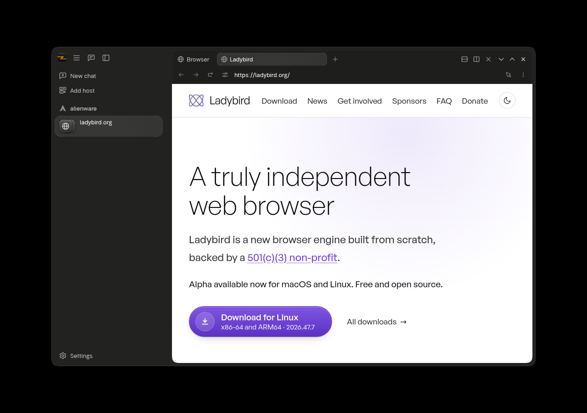

# Ladybird in a zz browser pane

This Linux x86-64 spike embeds the first Ladybird alpha, 2026.47.7, in zz's existing desktop browser pane. The adapter is commit `b4e3a2bcd`. The baseline is the default desktop from zz base `e6d337080` with CEF 156.0.15 and Chromium 156.0.8078.80. Ordinary desktop builds select CEF. [Ladybird release](https://github.com/LadybirdBrowser/ladybird/releases/tag/2026.47.7)



## Measurements

A separate controlled benchmark attributes memory and CPU to the zz desktop, terminal, Ladybird helpers and stock Qt frontend at two matched viewport sizes. [Browser resource baseline](baseline.md)

The first browser pane added 183 MiB above the terminal-only desktop with Ladybird and 431 MiB with CEF. Opening a second pane kept the same Hub. The first loopback page became ready 224 ms sooner with Ladybird. Scrolling a full pane cost 50% more process CPU, and building 800 rows and forcing ten layouts took 38% longer. Both engines delivered JavaScript animation callbacks near 60 Hz on the scrolling fixture.

Values are medians from five paired release runs, with minimum and maximum in parentheses. Pair 1 paged out up to 53 MiB of the CEF process tree. The summary uses pairs 2 through 6, where both engines stayed below 1 MiB of proportional swap at all three memory checkpoints. All six pairs are available for inspection. [Raw samples](../../bench/ladybird/samples.json)

| Measurement | Unit | CEF | Ladybird | Change |
|---|---|---:|---:|---:|
| Terminal-only desktop PSS | MiB | 229.91 (224.74–232.46) | 226.22 (223.84–232.69) | -1.6% |
| One browser pane, total PSS | MiB | 661.32 (654.47–663.23) | 408.93 (404.12–415.80) | -38.2% |
| One pane, PSS above terminal | MiB | 431.48 (428.86–432.44) | 182.94 (180.28–183.52) | -57.6% |
| Two browser panes, total PSS | MiB | 699.80 (691.85–704.35) | 428.04 (420.62–434.60) | -38.8% |
| First pane to page-ready callback | ms | 408.00 (368.00–613.00) | 184.00 (129.00–249.00) | -54.9% |
| Second pane to page-ready callback | ms | 99.00 (90.00–106.00) | 78.00 (73.00–88.00) | -21.2% |
| Split canvas, process CPU | s | 1.18 (1.13–1.29) | 1.03 (0.99–1.06) | -12.7% |
| Full-pane scroll, process CPU | s | 1.24 (1.12–1.27) | 1.86 (1.81–1.91) | +50.0% |
| Canvas animation callbacks | Hz | 60.14 (59.91–60.15) | 59.89 (59.75–59.91) | -0.4% |
| Scrolling animation callbacks | Hz | 59.96 (59.94–60.11) | 60.05 (60.00–60.13) | +0.2% |
| Canvas p95 callback interval | ms | 16.80 (16.70–16.80) | 16.70 (16.70–16.70) | -0.6% |
| Scroll p95 callback interval | ms | 16.70 (16.70–16.80) | 16.70 (16.70–16.70) | +0.0% |
| Integer JavaScript loop | ms | 8.70 (4.60–11.40) | 4.70 (4.30–14.80) | -46.0% |
| DOM build and ten layouts | ms | 46.70 (45.30–53.70) | 64.60 (59.50–73.90) | +38.3% |

A single CEF readback control took 1.68 CPU seconds for the scroll and used 667.5 MiB with one pane. The main comparison uses the CEF GPU configuration that zz ships. The readback control and both Ladybird profile checks produced the expected page pixels.

The test machine ran CachyOS Linux on an Intel i7-11800H with 16 logical CPUs, 15.4 GiB of RAM visible to Linux and an NVIDIA RTX 3070 Laptop GPU. A dedicated 1280 × 900 KWin virtual Wayland compositor hosted the desktop. Both executables used the workspace release profile, including fat LTO, the dev identity, and the same CLI. CEF used its default GPU shared-texture path. The Ladybird desktop ran from a bundle containing its own helpers and zero CEF runtime files. The harness checked the desktop's loaded memory mappings after the first page.

The packaged engine files occupied 324.3 MiB for CEF and 278.2 MiB for Ladybird, a saving of 46.1 MiB (14.2%). This counts regular files once, including resources and notices, and excludes the common CLI, the zz executable, filesystem metadata and user profiles. Compressed as separate tar streams with zstd level 3, the same trees occupied 133.9 MiB and 107.3 MiB respectively.

Including the optimized zz executable and identical CLI, the staged bundles totalled 468.4 MiB for CEF and 421.5 MiB for Ladybird.

Each trial starts a fresh desktop and profile. Engine files stay in the host's normal disk cache. One warm-up per engine precedes the measured pairs, with the engine order reversed on successive pairs. Another build shared this machine. The runner waited for under 40% host CPU use and under 5% memory pressure averaged over ten seconds before each trial. The raw data includes host swap counters and each process tree's proportional swap use.

PSS sums Linux proportional set size across the desktop and its browser children, excluding the daemon and terminal shell. The one-pane increment subtracts that run's terminal-only baseline. Page-ready time starts before the CLI command and ends when JavaScript reports a nontrivial viewport after animation callbacks. CPU seconds sum user and kernel time across that same process tree during navigation to the workload and four seconds of animation. GPU time, power and physical presentation were outside the measurement. The callback rates come from JavaScript. The separate microbenchmarks execute two million integer-loop iterations, then build 800 DOM rows and force ten layouts.

## Run it

Run either command from the worktree on Linux x86-64. The launcher needs the usual zz build dependencies, a working graphical session, `curl`, `ar`, and `tar`.

```sh
just ladybird run
just ladybird run 'https://en.wikipedia.org/wiki/Terminal_emulator'
```

`just ladybird build` verifies the official Ubuntu 24.04 package against its pinned SHA-256, extracts the engine helpers, resources, libraries and notices, and builds the release desktop and CLI. It stages everything under `target/ladybird-app`, or under `CARGO_TARGET_DIR/ladybird-app` when set. The launcher uses that bundle's own profile, config, cache, and daemon socket. The Qt browser and WebDriver executables are omitted.

## Integration

The adapter spawns the released Hub through an inherited Unix socket. Each zz profile owns a Hub. Each pane in a profile owns a separate view. The Hub manages networking, content and compositor processes. The desktop forwards navigation, focus, viewport changes and input over Hub IPC. Ladybird renders into shared-memory BGRA buffers, passes their file descriptors over the socket, and receives acknowledgements when a backing store becomes available again. The adapter copies the active rectangle into zz's frame mailbox. Ala uploads and presents it using its existing browser-pane renderer. [Pinned Hub protocol](https://github.com/LadybirdBrowser/ladybird/tree/2026.47.7/Services/Hub)

The existing GPUI project Elaris provided a reference for embedding Ladybird. This spike uses the released engine binaries directly and carries its own small Rust implementation of the messages zz needs. [Elaris](https://github.com/elarisbrowser/elaris)

## What ran

The end-to-end harness starts a real desktop client on a private daemon, opens a browser through the zz CLI, waits for JavaScript in a loopback page, and verifies a captured background pixel on the readback path. It types into a form, activates the button with Tab and Enter, opens a split, checks the new viewport and verifies that the second page can read the first page's local storage. It then navigates the split to a four-second animated canvas and a JavaScript and DOM workload, zooms the split to the full pane for four seconds of scrolling, and checks that a separately named profile starts with empty storage. Live HTTPS smoke tests rendered the Ladybird home page, a Wikipedia article and a GitHub repository. Those three checks covered initial page rendering. The final release launcher opened the Ladybird site directly. Closing both the release desktop and its daemon, then opening the same loopback origin on a second launch, advanced a value saved in local storage from one to two. The real-engine integration test also clicked with the mouse, scrolled with the wheel, loaded a data URL above the 64 KiB inline IPC limit, traversed history in both directions, and answered a JavaScript prompt.

## Scope

Linux x86-64 on Wayland was exercised. The wire IDs and field layouts follow one alpha tag. A subsequent Ladybird release needs a protocol check. macOS needs its own Hub transport and backing-store import. The original adapter forced CPU painting and copied each visible frame before acknowledging its backing store. The follow-up spike adds opt-in GPU sharing and measures composited scrolling. [GPU measurements](gpu.md) [Upstream shared image types](https://github.com/LadybirdBrowser/ladybird/blob/2026.47.7/Libraries/LibGfx/SharedImage.h)

The spike omits Chromium DevTools, element picking, Chrome-cookie import, zz's custom local URL scheme and remote-host proxy egress. Downloads, file pickers, popups, accessibility trees, clipboard integration, pre-edit IME composition and media controls need further implementation. Login flows, WebRTC, DRM, crash recovery, macOS and Windows were outside the measured workload.

## Reproduce the comparison

Build both desktops from the worktree with the dev identity so the harness can give each run a fresh profile. Install Python's Pillow and psutil. Run in a clean graphical session and use an empty output directory name for each invocation. `--readback` selects CEF's CPU-readable presentation path and enables its PNG assertion.

```sh
just ladybird build
ZZ_DEV_BUILD=1 cargo xtask bundle-cef --release --output target/cef-comparison
bench/ladybird/compare.py --binary target/cef-comparison/zz \
  --cli target/ladybird-app/cli --hub target/ladybird-app/runtime/libexec/Hub \
  --output target/cef-trial
bench/ladybird/compare.py --binary target/ladybird-app/zz \
  --cli target/ladybird-app/cli --hub target/ladybird-app/runtime/libexec/Hub \
  --output target/ladybird-trial
ZZ_LADYBIRD_HUB="$PWD/target/ladybird-app/runtime/libexec/Hub" \
  cargo test -p zz-browser-runtime --no-default-features --features ladybird -- --include-ignored
```
